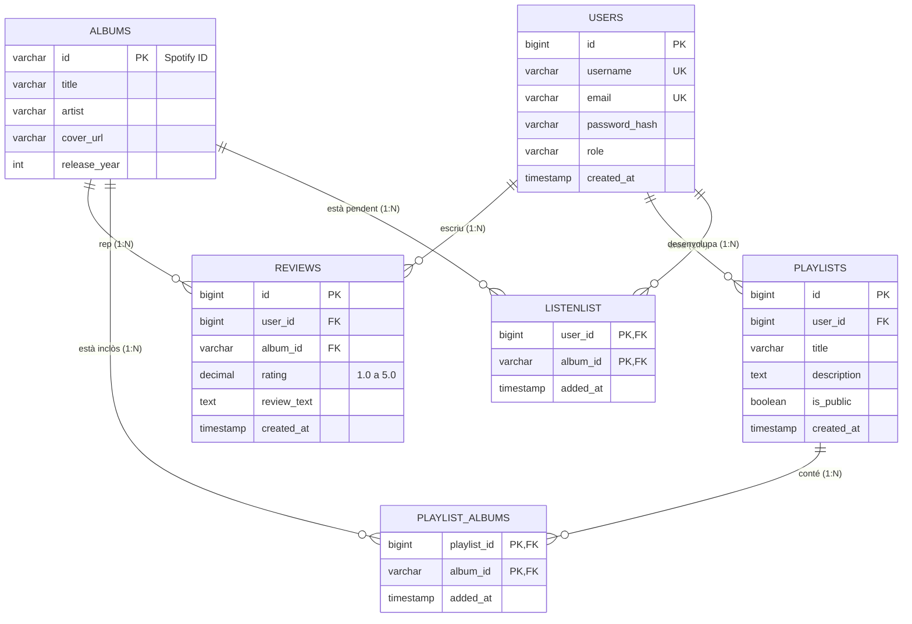

# Diagrama Entitat-Relació (Model Relacional) - SoundBoxd

**Mòdul**: MP0492 · AEA2 · Repte 1  
**Fitxer SQL**: `docs/bd/schema.sql`

## Justificació de la Persistència
1. **Clau d'Spotify com a PK d'Àlbums**: Evita redundàncies i permet emmagatzemar exclusivament les metadades dels discos que han estat avaluats o afegits a llistes.
2. **Relacions N:M amb claus compostes**: Tant `LISTENLIST` com `PLAYLIST_ALBUMS` utilitzen parelles de claus primàries que impedeixen discos duplicats a una mateixa llista.
3. **Integritat referencial `ON DELETE CASCADE`**: Garanteix l'eliminació automàtica de ressenyes i referències associades si un usuari decideix cancel·lar el seu compte.
